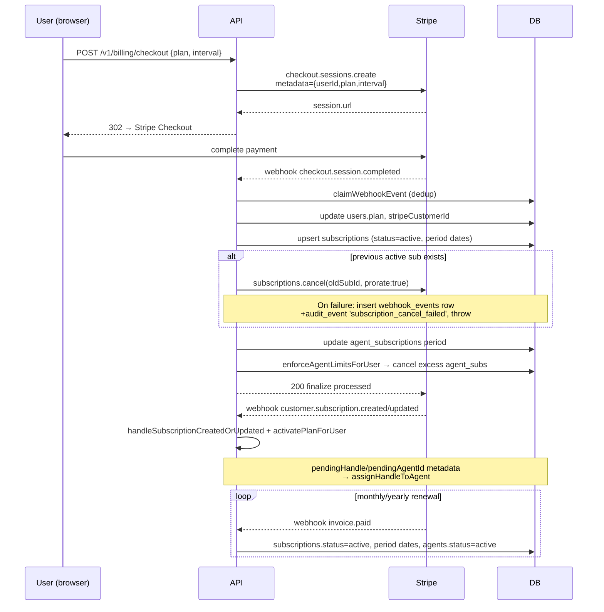
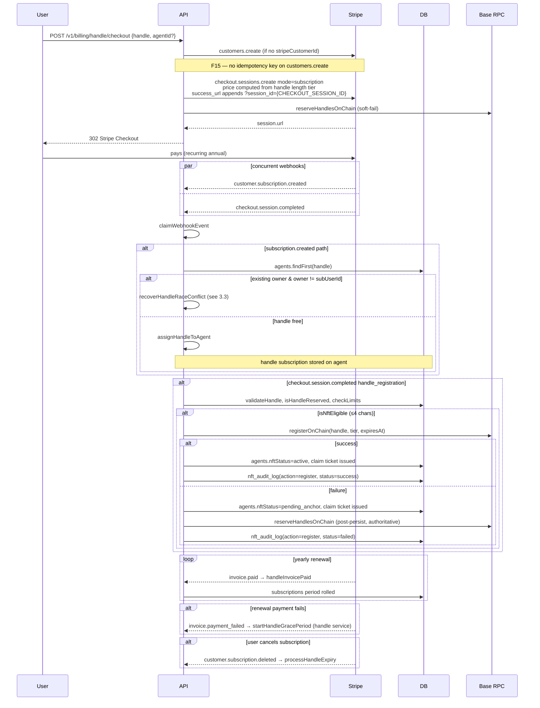
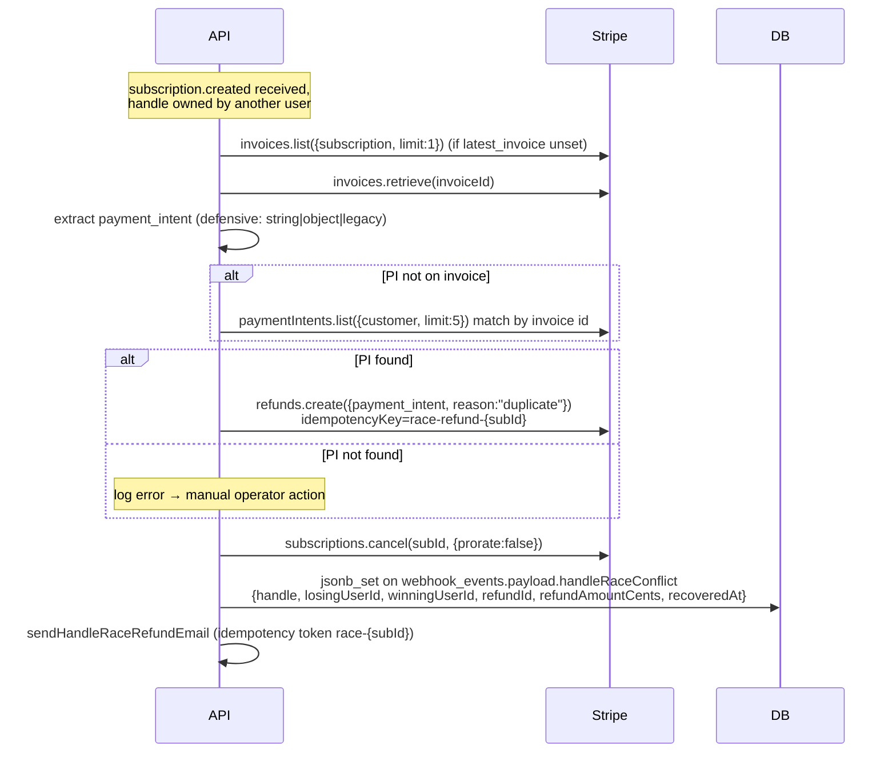
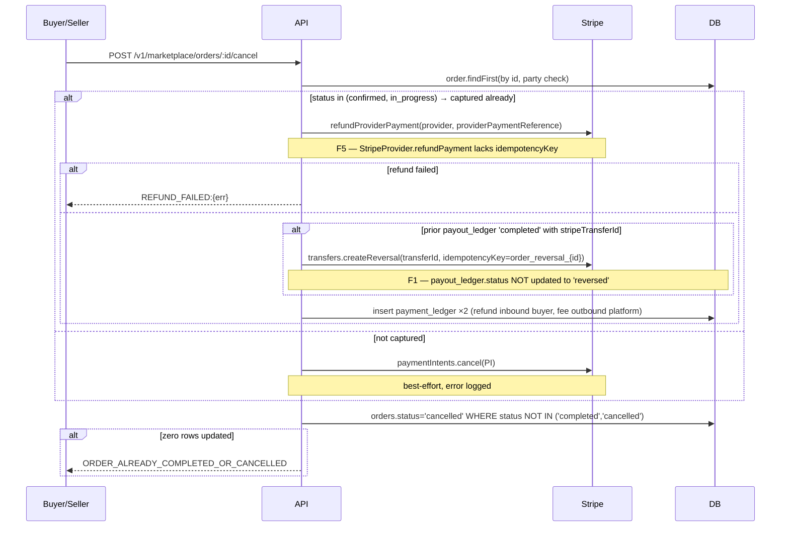
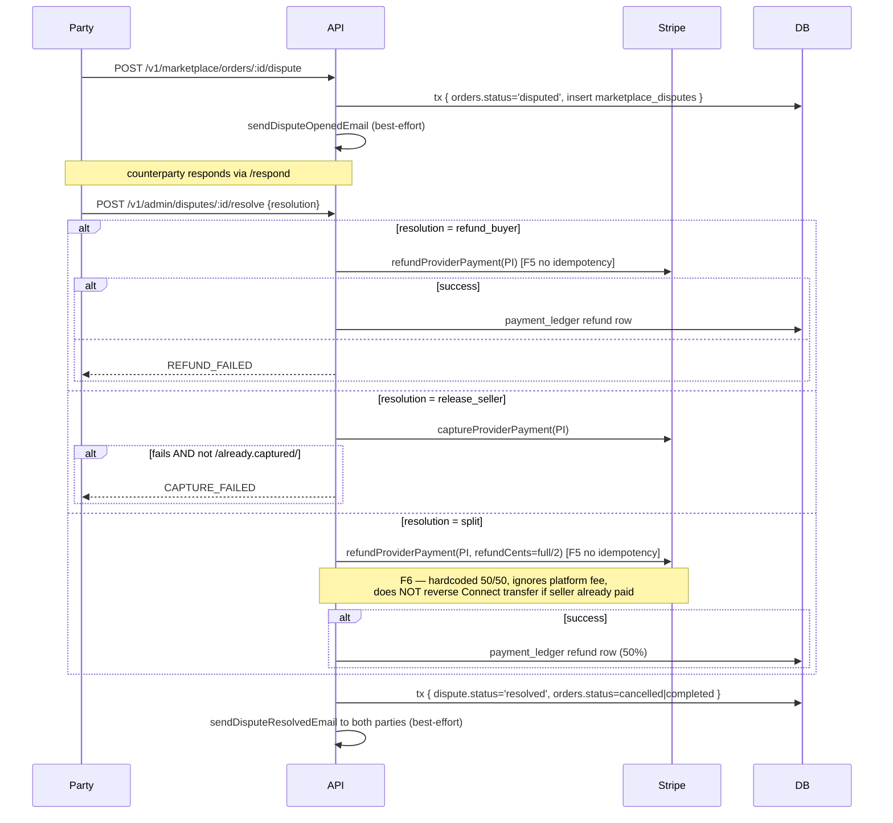
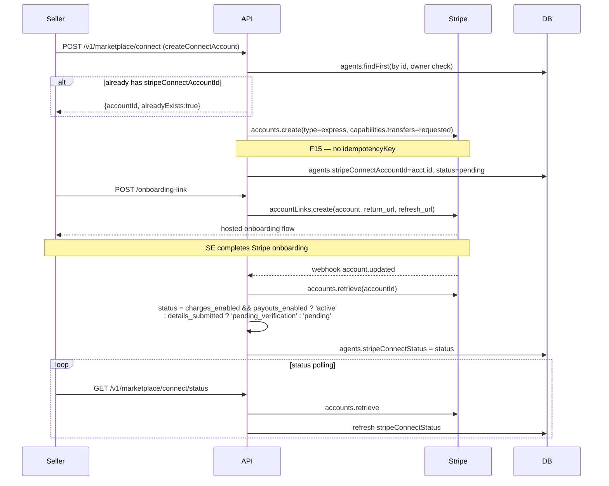
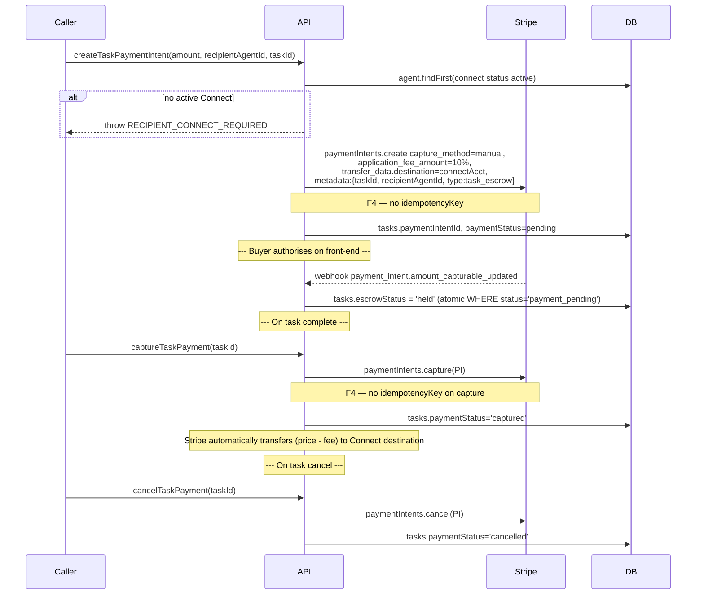

# Audit 04 — Billing, Stripe, and Payouts

**Scope:** Every monetary path on the Agent ID platform: handle purchase, plan subscription, marketplace order + escrow, milestone release, dispute refunds, Stripe Connect payouts, handle race refunds. Webhook ingestion is included only for Stripe-specific replay/timing/dedup concerns; generic webhook signature security is covered by audit 02.

**Out of scope:** Implementing fixes; signature scheme review beyond Stripe's `constructEvent` tolerance/replay; non-Stripe payment rails (Coinbase, Visa, x402) — these are stubbed `PROVIDER_UNAVAILABLE` in `payment-providers.ts` and are not currently moving money.

**Method:** Static read of `services/billing.ts`, `services/orders.ts`, `services/marketplace-milestones.ts`, `services/disputes.ts`, `services/stripe-connect.ts`, `services/payment-providers.ts`, `services/stripe-client.ts`, `routes/v1/webhooks.ts`, `routes/v1/billing.ts`, `routes/v1/marketplace.ts`, `routes/v1/admin.ts`, and the DB schemas under `lib/db/src/schema/`.

---

## 0. Executive Summary

The platform's billing surface is broad — handle subs, plan subs, marketplace orders, milestone escrow, Connect payouts, dispute refunds, race-conflict refunds, and a crypto/USDC side-channel. Most of the **happy paths** are correct: Stripe SDK signature verification, webhook dedup via `webhook_events`, atomic order/milestone state transitions with `WHERE status IN (...)` guards, and idempotency keys on the high-risk capture/transfer/reversal calls.

The **highest-priority gaps** are:

| # | Severity | Area | Gap |
|---|---|---|---|
| F1 | **High** | Connect payout reversal | `cancelOrder` reverses the Connect transfer best-effort but never updates `payout_ledger.status` or writes a reversal ledger row — a refunded order can leave a stale `completed` payout row claiming the seller was paid. |
| F2 | **High** | `charge.refunded` webhook | Handler only `logger.info`s — does **not** update order status, write a refund ledger entry, or decrement the seller payout row. Out-of-band refunds in the Stripe Dashboard are silently invisible to the DB. |
| F3 | **High** | Order PI metadata race | In `createOrder` the PaymentIntent is created **before** the `marketplace_orders` row exists, then patched with `orderId` afterwards. If the metadata `update` fails (logged, not thrown), the webhook can never route `payment_intent.succeeded` back to the order. |
| F4 | **High** | Idempotency-key gaps | `paymentIntents.create` lacks idempotency keys in `orders.createOrder`, `marketplace-milestones.createMilestones`, `stripe-connect.createTaskPaymentIntent`, `agentic-payment.processAgentUpgrade`, and the generic `StripeProvider.createIntent`. A retried HTTP request can mint **duplicate holds** on the buyer's card. |
| F5 | **High** | Refund idempotency | `StripeProvider.refundPayment`, `StripeMppProvider.refundPayment`, and the dispute split-refund path all lack idempotency keys. A retry of `resolveDispute` can issue a **double refund**. |
| F6 | **High** | Platform-fee accounting on refund | `dispute.split` always refunds 50/50, ignores platform fee, and doesn't reverse the Connect transfer. Result: full refund-buyer disputes after a `release_seller` capture leave the seller with the money and the buyer also refunded. |
| F7 | **Med** | Connect transfer separate from capture | `completeOrder` and `releaseMilestoneEscrow` use `paymentIntents.capture` followed by a separate `transfers.create` (no `transfer_data.destination` on the PI). If capture succeeds and transfer fails, the platform holds the buyer's money but the ledger marks the seller as `pending_manual_payout` — operator must reconcile manually. |
| F8 | **Med** | Hardcoded fee inconsistency | Order-level uses `calculatePlatformFee` (10% via `PLATFORM_FEE_RATE` in `marketplace.ts`); milestones hardcode `platformFeeRate = 0.10`; `MARKETPLACE_FEE_BPS = 250` (2.5%) is exported from `billing.ts` and **never read**. Three sources of truth, one of them unused, no env-driven control. |
| F9 | **Med** | PI hold expiry | Manual-capture PaymentIntents (escrow) expire after ~7 days. There is **no monitor** for unaging holds. Long milestone work or dispute review windows can silently void escrow. |
| F10 | **Med** | `account.updated` capability handling | Webhook only stores `active`/`pending_verification`/`pending`. It does **not** flag specific capability loss (`charges_enabled` flips false), does not pause/quarantine listings, and does not notify the seller. |
| F11 | **Med** | LAUNCH_MODE has no end-of-launch reconciler | `LAUNCH_MODE=true` grants every plan-gated feature to every user. There's no script to revoke entitlements, downgrade users, or pause public agents when launch ends. |
| F12 | **Med** | `PLATFORM_ACCOUNT_ID` is a placeholder UUID | `00000000-0000-0000-0000-000000000000` is hardcoded in `disputes.ts` and `orders.ts` for ledger entries; if ever joined to `users` it will not resolve. |
| F13 | **Med** | Webhook-handler bodies are not transactional | Most handlers do multiple sequential DB writes (orders, ledger, listings hires counter, audit). A mid-handler crash leaves the row in an inconsistent state and the webhook is finalized as `failed` — Stripe will retry and re-enter the partial-update branch. |
| F14 | **Low** | `extractSubscriptionId` schema drift | Reads `invoice.parent.subscription_details.subscription` and falls back to legacy `(invoice as any).subscription`. Stripe API version pinned to `2025-04-30.basil`; brittle if updated. |
| F15 | **Low** | `customers.create`, `accounts.create`, `products.create` lack idempotency keys | Low-risk (not money-moving) but a retried customer-create produces orphaned Stripe customers. |
| F16 | **Low** | Crypto payment poller is one-shot | `pollForCryptoPayment` scans the last 1000 blocks once; no scheduler re-runs it on a cadence. Payments arriving after the user closes the page never settle. |
| F17 | **Low** | Webhook dedup index allows nullable `providerEventId` | `webhook_events.providerEventId` is nullable but the unique index includes it; multiple null rows can collide. Defensive only — Stripe always sets `event.id`. |

Detailed per-flow analysis follows.

---

## 1. Stripe Client + Environment Safety

`services/stripe-client.ts` resolves the SDK as follows:

1. Production (`NODE_ENV=production`) prefers `STRIPE_LIVE_SECRET_KEY`, else `STRIPE_SECRET_KEY`.
2. **Cross-env guard:** throws FATAL if a `sk_test_`/`rk_test_` key is detected in prod, or `sk_live_`/`rk_live_` in non-prod.
3. Falls back to the Replit Stripe connector proxy (`new ReplitConnectors().createProxyFetch("stripe")`) when no key is configured.
4. `bootstrapStripeEnv()` lazily hydrates `STRIPE_SECRET_KEY`, `STRIPE_PUBLISHABLE_KEY`, `STRIPE_WEBHOOK_SECRET` from the connector at boot.

**Strength:** Cross-env detection is a hard FATAL — explicit and correct. Pinned API version `2025-04-30.basil` avoids silent SDK semantic changes.

**Gap (F14, low):** When the SDK falls back to the connector proxy, **webhook signature verification still requires `STRIPE_WEBHOOK_SECRET`** (verified in `verifyStripeWebhook`). If the connector grants API access but `STRIPE_WEBHOOK_SECRET` is unset, the `/v1/webhooks/stripe` endpoint returns `503 WEBHOOK_NOT_CONFIGURED`. This is fine but undocumented.

---

## 2. Webhook Ingestion (Stripe-specific only)

`routes/v1/webhooks.ts` (note: lives at `routes/v1/webhooks.ts`, **not** `routes/webhooks.ts` as the task spec lists).

### 2.1 Signature, Timing, Replay

```ts
verifyStripeWebhook(rawBody: Buffer, signature: string): Stripe.Event {
  return stripe.webhooks.constructEvent(rawBody, signature, webhookSecret);
}
```

- Signature is HMAC-SHA256, validated by Stripe SDK.
- **Tolerance:** Stripe SDK default = **300s (5 minutes)**. Not overridden. Acceptable.
- **Replay:** No application-level signature timestamp check beyond what `constructEvent` does. Replay protection at the application layer is via the `webhook_events` dedup table (see 2.2).
- **Raw body handling:** `raw({ type: "application/json" })` is mounted on the route, ensuring body is a `Buffer` for HMAC verification. **Correct.**

### 2.2 Dedup / Idempotency at Webhook Layer

```ts
const claimResult = await claimWebhookEvent("stripe", event.type, event.id, event.data.object);
if (claimResult === "already_processed") { return res.json({ received: true, status: "already_processed" }); }
```

`claimWebhookEvent` (billing.ts:1576):

- Looks up `(provider, providerEventId)` in `webhook_events`.
- If status is `processed` or `skipped` → returns `"already_processed"`, handler short-circuits.
- If status is `pending`/`failed` → resets to `pending` and returns `"retrying"`.
- Otherwise inserts a new row with `onConflictDoNothing` on `(provider, providerEventId)`.

Pairs with `finalizeWebhookEvent(... "processed" | "failed" | "skipped")` in finally-style paths.

**Strength:** Unique index on `(provider, providerEventId)` enforces dedup at the DB layer.

**Gaps:**

- **F13:** `claimWebhookEvent` opens a logical claim, but the handler body is not transactional. If the body crashes between `claimWebhookEvent` returning `"claimed"` and `finalizeWebhookEvent("processed")`, the row is finalized as `"failed"` and the **next Stripe retry will re-enter the body** — re-executing partial side effects. Per-handler idempotency must therefore be defensive (and is, only inconsistently — see F4/F5).
- **F17 (low):** `webhook_events.providerEventId` column is nullable. Stripe always supplies an `event.id`, so this is theoretical, but a defensive `NOT NULL` would be cleaner.
- The handler uses a `switch` and finalizes with `"skipped"` for unknown event types. **Correct** — unknown events do not get retried.

### 2.3 Event Routing Map

| Event | Handler | Notes |
|---|---|---|
| `checkout.session.completed` | `handleCheckoutCompleted` | Branches on `metadata.type`: `handle_mint_request`, `handle_registration`, plan checkout. |
| `invoice.paid` | `handleInvoicePaid` | Renews subscription period; reactivates user/agents. |
| `invoice.payment_failed` | `handleInvoicePaymentFailed` | If subscription is a handle sub → start grace period; else mark `past_due` + downgrade to `free`. |
| `customer.subscription.created`/`updated` | inline handler + `handleSubscriptionCreatedOrUpdated` + `activatePlanForUser` | Handle-registration branch checks for race conflict and triggers `recoverHandleRaceConflict`. Pending onboarding handles assigned post-plan. |
| `customer.subscription.deleted` | inline handler + `handleSubscriptionDeleted` + `deactivatePlanForUser` | Handle subs trigger `processHandleExpiry`; plan subs cancel + downgrade to `free`. |
| `payment_intent.succeeded` | `handlePaymentIntentSucceeded` | Advances `marketplace_orders.payment_pending → pending`. |
| `payment_intent.amount_capturable_updated` | `handlePaymentIntentCapturableUpdated` | Advances tasks (escrow `payment_pending → held`) and orders (`payment_pending → pending`). Authoritative for manual-capture buyer-confirmed signal. |
| `payment_intent.payment_failed` | `handlePaymentIntentFailed` | Marks order `payment_failed`. |
| `charge.refunded` | `handleChargeRefunded` | **F2: log only.** No DB updates, no ledger row. |
| `account.updated` | `handleConnectAccountUpdated` | Maps to `active`/`pending_verification`/`pending`. **F10: capability-loss not handled.** |
| `transfer.failed` | `handleTransferFailed` | Updates payout_ledger by `metadata->>'stripeTransferId'` and emails seller. **Correct.** |
| anything else | finalize as `skipped` | Correct. |

**Notable absent handlers:**

- `charge.dispute.created`, `charge.dispute.closed`, `charge.dispute.funds_withdrawn`, `charge.dispute.funds_reinstated` — **a Stripe-side cardholder chargeback (not the platform's "dispute" flow) is invisible to the DB.** The platform's `marketplace_disputes` table is for buyer↔seller disputes, separate from card-network disputes.
- `payout.failed`, `payout.paid` — Connect destination-account payouts to seller bank are not tracked.
- `radar.early_fraud_warning` — no fraud signal ingestion.
- `customer.subscription.trial_will_end` — no trial UX.
- `invoice.upcoming` — no proactive renewal warning.
- `setup_intent.*` — no saved-payment-method flow.

---

## 3. Flow Diagrams

### 3.1 Plan Subscription (starter / pro)

Create-checkout: `POST /v1/billing/checkout` → `createCheckoutSession` (billing.ts) → `stripe.checkout.sessions.create` with `metadata.{userId, plan, billingInterval}`. Returns hosted Stripe URL.



**Idempotency:**

| Operation | Strategy | Notes |
|---|---|---|
| `checkout.sessions.create` | None on Stripe side | Buyer-driven; a duplicate click creates a duplicate session — Stripe Checkout itself is the rate-limiter. **Acceptable.** |
| Webhook handler | `claimWebhookEvent` dedup on `event.id` | Strong. |
| `users.plan` update | Last-write-wins | Acceptable; webhook order tolerated. |
| `subscriptions` upsert | Existence check then update vs insert | Race-prone if two `checkout.session.completed` fire concurrently for the same user (rare, but possible on chained checkouts). Could double-insert active subs. **Gap (low).** |
| `subscriptions.cancel(oldSubId)` | Stripe is idempotent on already-cancelled subs | OK. On failure, throws → webhook retries. |
| `enforceAgentLimitsForUser` | Idempotent (status set unconditionally) | OK. |

**Failure modes:**

- **F13:** Crash between `update users.plan` and `upsert subscriptions` leaves user on the new plan with no subscription row → next `getActiveUserSubscription` returns null → user downgraded. Webhook retry recovers.
- Old subscription cancel failure → throws → webhook marked `failed` → Stripe retries. The audit event/webhook_events row records the failure. **Operator-visible, correct.**
- `invoice.paid` arriving before `checkout.session.completed` (possible because Stripe webhook ordering is not guaranteed) → `subscriptionsTable` lookup fails → handler returns silently. **Gap (low):** no recovery; the user remains on the previous (or no) plan until a manual webhook replay.

**Gaps:**

- No proration audit on plan change — relies on Stripe's defaults.
- No `customer.subscription.trial_will_end` handler; no trial mechanism currently exists.
- No `invoice.upcoming` warnings; no preemptive dunning UX.

### 3.2 Handle Purchase — Yearly Subscription Path

`createHandleCheckoutSession` (billing.ts:1170+) creates a Stripe Checkout in `mode: "subscription"` with `recurring: { interval: "year" }`, metadata `{ type: "handle_registration", userId, handle, agentId? }`.

Pre-checkout side effect: best-effort `reserveHandlesOnChain([handle])` (soft-fail). Authoritative reservation occurs again post-persist on webhook.



**Idempotency:**

| Operation | Strategy |
|---|---|
| `customers.create` | **None (F15)** — orphaned customer rows possible on retry. |
| `checkout.sessions.create` | None — buyer-driven session. |
| `agents.findFirst(handle)` | Used as authority before insert; the unique constraint on `agents.handle` is the source of truth. |
| Webhook handlers | `claimWebhookEvent` dedup. |
| `assignHandleToAgent` | Atomic update on agent row; safe to retry. |
| `registerOnChain` | Has its own on-chain idempotency (handle uniqueness in registry). |

**Failure modes:**

- Two users complete checkout simultaneously for the same handle → DB unique constraint wins for one, the other triggers `HANDLE_RACE_CONFLICT` recovery (see 3.3).
- `reserveHandlesOnChain` failure → soft-logged; the **post-persist call** in `checkout.session.completed` is the authoritative reservation. Acceptable.
- `customer.subscription.created` arrives before `agents` row exists for the handle → branch `if (existingOwner) ... else ... if (agent)` returns silently. **Gap (low):** webhook idempotency replay would handle it on Stripe's redelivery cadence (24h backoff), but until then the agent has no handle assignment — UX shows "pending."
- `registerOnChain` succeeds **but** subsequent DB update fails → on-chain handle is registered to `nftCustodian: "platform"` with no DB record → **orphaned NFT.** The audit log write is best-effort and may also fail.

**Gaps:**

- No yearly renewal cron / drift monitor for handles whose Stripe sub was cancelled but DB still shows `active`. Reliance entirely on `customer.subscription.deleted` webhook.
- `processHandleExpiry` happens immediately on subscription deletion — there is no operator review window for cancellations made in error.
- Handle-tier pricing (3/4/5+ char) computed client-side in `getHandlePriceCents`. Webhook re-derives from `subscription.metadata.handle` length, not from the actual amount paid; if Stripe price was overridden in the dashboard the platform wouldn't notice.

### 3.3 Handle Race Refund (`recoverHandleRaceConflict`)

Triggered from the `customer.subscription.created/updated` webhook when `existingOwner.userId !== subUserId` for the requested handle.



**Strengths:**

- `idempotencyKey: race-refund-{subscription.id}` on the refund — duplicate webhooks won't issue duplicate refunds.
- `subscriptions.cancel` is idempotent on Stripe's side (cancelling an already-cancelled sub is a no-op error pattern).
- `jsonb_set` audit write is keyed on `(provider, providerEventId)` — also safe to retry.
- `sendHandleRaceRefundEmail` uses a per-subscription idempotency token to avoid double-sends.
- Catch-all `try/catch` ensures the webhook never returns 5xx because of refund issues — refund is best-effort, the webhook should not be retried unnecessarily.

**Gaps:**

- **No alert** on the "PI not located" branch; only a structured log. If the invoice→PI lookup chain fails, only log scraping reveals it.
- The webhook is finalized as `"processed"` even when the refund fails — the failed refund will not be re-attempted on Stripe redelivery because the dedup table short-circuits.
- `refundAmountCents` may be null if invoice has no `amount_paid` and refund object is also missing `amount` — email sends with `getHandlePriceCents(handle)` fallback, which may not match the actual refund.
- No reversal of the on-chain reservation that may have been written speculatively at checkout creation. (Reservation is non-binding so this is a low impact.)
- The losing user's `agentId` (if any) is not cleaned up — they may have a draft agent pointing at a handle they never received.

### 3.4 Marketplace Order — Single-shot (no milestones)

```mermaid
sequenceDiagram
  participant B as Buyer
  participant API
  participant S as Stripe
  participant DB
  participant CONN as Stripe Connect (seller)
  B->>API: POST /v1/marketplace/orders {listingId, package?}
  API->>DB: marketplace_listings.findFirst(active)
  API->>API: calculatePlatformFee (10% PLATFORM_FEE_RATE)
  API->>S: paymentIntents.create amount, currency:usd<br/>capture_method:manual<br/>metadata:{buyerUserId, sellerUserId, listingId, listingTitle}
  Note over API,S: F4 — no idempotencyKey
  API->>DB: insert marketplace_orders status=payment_pending,<br/>providerPaymentReference=PI.id
  API->>S: paymentIntents.update(PI, metadata:{orderId,...})
  Note over API,S: F3 — if this fails (logged not thrown),<br/>webhook can never route by orderId
  API-->>B: {clientSecret}
  B->>S: confirm card
  S-->>API: webhook payment_intent.amount_capturable_updated
  API->>DB: orders.payment_pending → pending (atomic WHERE status=payment_pending)
  Note over B,API: buyer can also POST /v1/marketplace/orders/:id/confirm-payment
  B->>API: POST /confirm-payment
  API->>S: paymentIntents.retrieve, assert status=requires_capture
  API->>DB: orders.payment_pending → pending
  API->>API: submitTask → notifies seller
  Note over API: Seller delivers work
  participant SE as Seller
  SE->>API: POST /confirm (acknowledges) → status=confirmed (capture if no milestones)
  SE->>API: POST /complete (after delivery)
  API->>DB: atomic update status confirmed/in_progress → completed
  alt seller has active Connect
    API->>S: paymentIntents.retrieve
    alt status=requires_capture
      API->>S: paymentIntents.capture(PI, idempotencyKey=order_capture_{orderId})
      API->>S: transfers.create(amount=sellerPayout, destination=connectAcct,<br/>idempotencyKey=order_transfer_{orderId})
      Note over API,CONN: F7 — capture and transfer are separate calls;<br/>capture-success+transfer-fail leaves platform holding funds
    else status=succeeded
      API->>S: transfers.create (idempotent)
    end
  else fallback
    Note over API,DB: payoutStatus = pending_manual_payout
  end
  API->>DB: insert payout_ledger {status, transferId, connectAcctId}
  API->>DB: insert payment_ledger ×3 (buyer outbound, platform inbound fee, seller inbound)
  API->>DB: marketplace_listings.totalHires++
  API->>API: logActivity, sendOrderCompletedEmail (buyer + seller)
```

**Idempotency keys:**

| Op | Key | Status |
|---|---|---|
| `paymentIntents.create` | none | **F4 high** |
| `paymentIntents.update(metadata)` | none | OK — patch semantics |
| `paymentIntents.capture` | `order_capture_${orderId}` | OK |
| `transfers.create` | `order_transfer_${orderId}` | OK |
| Order status flip | atomic `WHERE status IN ('confirmed','in_progress')` | OK — single-row claim |

**Failure modes:**

- **F3:** `createOrder` window — PI exists with metadata `{buyerUserId, sellerUserId, listingId}` but no `orderId` until the post-insert update succeeds. If the user pays in this window and the update has not landed, the `payment_intent.amount_capturable_updated` and `payment_intent.succeeded` webhooks both early-return (`if (!pi.metadata?.orderId) skip`). Order remains in `payment_pending` indefinitely. Only manual operator intervention recovers.
- **F4:** Network-flaky `createOrder` retried by client → two PIs, two holds, two orders, only one with the buyer's `clientSecret` → buyer is double-authorized.
- **F7:** `paymentIntents.capture` succeeds, `transfers.create` fails → platform holds money, ledger records `pending_manual_payout`. The retry of `completeOrder` is blocked by the order being already in `completed` status. **Manual reconciliation only.** No background job re-tries `transfers.create`.
- Listing `totalHires` increment runs even when payout failed — counter is decoupled from money movement. **Acceptable** but worth noting.
- Order completion email sends inside the same handler; an email failure is caught and logged without rolling back. **Acceptable.**

**Connect gating:** `marketplace.checkListingEligibility` requires `requireConnect` for publish; legacy listings without Connect can still receive orders and fall through to `pending_manual_payout`.

### 3.5 Marketplace Order — Milestone Escrow

Per-milestone PaymentIntents, each `capture_method: "manual"`, replace the order-level PI.

```mermaid
sequenceDiagram
  participant API
  participant S as Stripe
  participant DB
  Note over API: Buyer or seller creates milestones
  loop for each milestone
    API->>S: paymentIntents.create amount=milestone.amount<br/>metadata:{orderId, milestoneTitle, idx, buyer, seller, listing}
    Note over API,S: F4 — no idempotencyKey
  end
  alt order has prior order-level PI
    API->>S: paymentIntents.cancel(orderPI)
    Note over API,S: best-effort; if fails, duplicate hold
  end
  alt PI creation failure mid-loop
    loop cleanup created PIs
      API->>S: paymentIntents.cancel(pi.id) (best-effort)
    end
    API-->>API: throw MILESTONE_PI_CREATION_FAILED
  end
  loop for each milestone
    API->>DB: insert marketplace_milestones row {stripePaymentIntentId, status=pending}
  end
  Note over API: --- Buyer authorises each milestone PI on the front-end ---
  Note over API: --- Seller marks milestone complete ---
  participant SE as Seller
  SE->>API: POST /milestones/:id/complete
  API->>DB: atomic WHERE status IN ('pending','in_progress') → completed
  Note over API: --- Buyer releases escrow ---
  participant B as Buyer
  B->>API: POST /milestones/:id/release
  API->>S: paymentIntents.retrieve(milestonePI)
  alt pi.status = requires_capture
    API->>S: paymentIntents.capture(milestonePI, idempotencyKey=milestone_capture_{id})
  else pi.status = succeeded
    Note over API,S: idempotent — already captured
  else other
    Note over API: PAYMENT_INTENT_INVALID_STATE
  end
  alt seller has active Connect
    API->>S: transfers.create(sellerPayout=capturedAmt*0.9,<br/>destination=connectAcct,<br/>idempotencyKey=milestone_transfer_{id})
    Note over API,S: F8 — hardcoded 0.10 fee, diverges from MARKETPLACE_FEE_BPS
  end
  API->>DB: tx { milestones.status=released (atomic),<br/>orders.releasedAmount += capturedAmount,<br/>payout_ledger insert }
```

**Idempotency:**

| Op | Key | Status |
|---|---|---|
| `paymentIntents.create` per milestone | none | **F4 high** — retry creates duplicate PIs and orphans them |
| `paymentIntents.cancel(orderPI)` | none | best-effort; idempotent on Stripe |
| `paymentIntents.capture` | `milestone_capture_${milestoneId}` | OK |
| `transfers.create` | `milestone_transfer_${milestoneId}` | OK |
| Milestone status flip | atomic `WHERE status='completed'` inside tx | OK |
| Order `releasedAmount` increment | `+=` inside the same tx | OK; single-writer per release |

**Failure modes:**

- **F4:** `createMilestones` mid-loop failure cleanup uses `paymentIntents.cancel` best-effort; if cancel itself fails (network), the buyer holds N stale authorisations. The cleanup also doesn't track which PIs were already DB-inserted — but DB inserts come **after** the loop, so this is a minor positive.
- **F8:** Milestone payout uses `platformFeeRate = 0.10` hardcoded inside `releaseMilestoneEscrow`, while `services/marketplace.ts::calculatePlatformFee` also uses 0.10 (`PLATFORM_FEE_RATE`). They agree today, but `MARKETPLACE_FEE_BPS = 250` (2.5%) exported from `billing.ts` is **dead code** — no caller reads it. This implies fee policy was meant to be 2.5% but was never wired in. **Either align all paths to 10% via a single env knob or fix the BPS reading.**
- Capture-success + transfer-fail (F7 again) → milestone marked `released`, `payout_ledger.status = pending_manual_payout`, no automated retry.
- The "PI cancel after creating per-milestone PIs" is best-effort: failure leaves a duplicate authorisation on the buyer card until Stripe expires it (~7 days).
- No verification that the sum of milestone amounts matches `order.priceAmount` — over-allocation possible.

### 3.6 Order Cancellation + Refund



**Failure modes / gaps:**

- **F1 (high):** Successful `transfers.createReversal` does not update `payout_ledger.status` (no `'reversed'` value, no metadata patch). The ledger still shows the seller as paid even though the transfer was reversed.
- **F5 (high):** No idempotency key on the refund → retried cancel issues a second refund (Stripe DOES protect against duplicate full refunds via 400 errors, but partial refunds on the same PI are accepted).
- The order-status flip is atomic, but the order of operations is **refund → reversal → ledger**. A crash after refund but before the reversal/ledger inserts leaves an inconsistent state on retry: a second refund attempt fails (full PI already refunded), but the reversal will be re-attempted (idempotency key saves it), and the ledger inserts will run again, **double-writing** the buyer-refund and platform-fee-reversal rows.
- If the order had milestones, `cancelOrder` does **not** iterate per-milestone PIs to refund/cancel them. The `providerPaymentReference` on the order row is the original (now-cancelled) order-level PI — refunding it is a no-op (or 404). Milestone-mode order cancellation is **broken**.

### 3.7 Disputes (`services/disputes.ts`)

Buyer↔seller dispute, NOT a Stripe card-network dispute.



**Strengths:** State transitions are inside transactions; the dispute resolve check (`if dispute.status === 'resolved' return error`) protects against double-resolution.

**Gaps:**

- **F5:** `refundProviderPayment` lacks an idempotency key — a network retry from the admin UI can issue a double refund.
- **F6:**
  - Hardcoded 50/50 split. Operator cannot specify a different ratio without code change (the `adminNote` field is just text).
  - Split refund returns 50% of the **full** price to the buyer, but the platform fee was paid out of the gross. Net result: platform absorbs half of its own fee implicitly.
  - If `release_seller` had previously been called by `completeOrder` (e.g. dispute opened *after* completion), capture is already done — and a `refund_buyer` resolution **does not reverse the Connect transfer**. Seller keeps the money, buyer also gets refunded → platform double-pays.
- `getOrderContext` reads `order.providerPaymentReference` — for milestone orders this is the (cancelled) order-level PI, **not** any milestone PI. Milestone-order dispute resolution is silently broken: it skips payment action with a warning, then transitions order to `completed`/`cancelled` without touching the per-milestone PIs.
- `release_seller` uses `captureProviderPayment` directly — it doesn't trigger any `transfers.create` to a Connect destination. If the order had a Connect-enabled seller, capture goes to the platform balance with no follow-up payout. Diverges from `completeOrder`'s capture+transfer pattern.

### 3.8 Stripe Connect — Account, Onboarding, Capabilities



**Gaps:**

- **F10:** `account.updated` ignores capability-loss signals. If `charges_enabled` flips false (e.g. Stripe risk-disabled the account), the agent is downgraded from `active` → `pending_verification`/`pending`, but **listings are not paused**, **in-flight orders are not flagged**, and **the seller is not emailed**. Buyers placing new orders will fall through to `pending_manual_payout`.
- **F15:** `accounts.create` lacks idempotency — duplicate onboarding click can create two Express accounts.
- The cached `stripeConnectStatus` is used as a fallback when Stripe API is unavailable. Could mask account deletion: a deleted Connect account stays "active" in cache until the next successful `getConnectAccountStatus` poll.
- No handling of `account.application.deauthorized` — if seller revokes the Connect connection, the platform doesn't know.

### 3.9 Connect Payout Flow (within `completeOrder` / `releaseMilestoneEscrow`)

Already diagrammed in 3.4 and 3.5. Highlight:

- The PaymentIntent **does not** use `transfer_data.destination` (split charges) for marketplace orders or milestones. Instead the platform uses **separate charges + transfers** — capture goes to platform balance, then a separate `transfers.create` moves funds to the seller's connected account.
- `services/stripe-connect.ts::createTaskPaymentIntent` (the **task escrow** path, separate from marketplace orders) **does** use `transfer_data.destination` + `application_fee_amount` (10%). Inconsistent with marketplace flow — two different settlement models in one codebase.
- No handling of `transfers.created` webhook — relies on synchronous `transfer.id` returned from `transfers.create`.
- `transfer.failed` webhook handler exists and updates `payout_ledger.status='failed'` plus emails the seller. **Strength.** But the transfer-failed path does not refund the buyer or revert the order status — operator must intervene.
- No handling of insufficient platform-balance scenarios. `transfers.create` will 402 — caught and logged, status falls back to `pending_manual_payout`. Operator-only recovery.

### 3.10 Task Escrow (`stripe-connect.ts::createTaskPaymentIntent`)

Used by agent-to-agent paid task flow, **not** marketplace orders. `application_fee_amount` + `transfer_data.destination` style.



**Strengths:**

- Uses Stripe's `transfer_data.destination` — capture and transfer are atomic on Stripe's side. Strictly safer than the marketplace separate-transfer pattern.
- `RECIPIENT_CONNECT_REQUIRED` enforced at intent-create time.

**Gaps:**

- **F4:** Both `paymentIntents.create` and `paymentIntents.capture` lack idempotency keys.
- `captureTaskPayment` returns silently if `paymentStatus === 'captured'`; protects against double-capture but not against the inverse race (capture call first, DB update concurrent).
- F9 hold expiry applies — captures must occur within ~7 days of authorisation.
- No webhook handler tracks the implicit transfer that Stripe creates from `transfer_data` — if it fails, the platform learns via `transfer.failed` (handled), but the link from `transfer.metadata` to the task is via `metadata.taskId` which is **not set** when Stripe creates the transfer (only PI metadata is set).

### 3.11 Crypto/USDC Side-channel (`createCryptoCheckoutSession` + `pollForCryptoPayment`)

Out of scope for Stripe but relevant because it shares the handle-purchase end state.

- One-shot poller (F16); no scheduler.
- No idempotency: two calls to `pollForCryptoPayment` for the same reference both find the matching transfer and both attempt `assignHandleToAgent` and `registerOnChain`. The DB unique constraint on `agents.handle` prevents double-assign, but the `nft_audit_log` writes both succeed.

---

## 4. Idempotency Audit (Consolidated)

### 4.1 Stripe API calls — every site

| File | Function | Operation | Idempotency Key | Risk |
|---|---|---|---|---|
| `services/marketplace-milestones.ts:45` | `createMilestones` | `paymentIntents.create` | **none** | Duplicate hold per milestone (F4) |
| `services/marketplace-milestones.ts:197` | `releaseMilestoneEscrow` | `paymentIntents.capture` | `milestone_capture_${id}` | OK |
| `services/marketplace-milestones.ts:240` | `releaseMilestoneEscrow` | `transfers.create` | `milestone_transfer_${id}` | OK |
| `services/marketplace-milestones.ts:63` | `createMilestones` | `paymentIntents.cancel` (orderPI) | none | Idempotent on Stripe |
| `services/marketplace-milestones.ts:76` | `createMilestones` (cleanup) | `paymentIntents.cancel` | none | Idempotent on Stripe |
| `services/orders.ts:72` | `createOrder` | `paymentIntents.create` | **none** | Duplicate buyer hold (F4) |
| `services/orders.ts:118` | `createOrder` | `paymentIntents.update(metadata)` | n/a | Patch semantics |
| `services/orders.ts:351` | `completeOrder` | `paymentIntents.capture` | `order_capture_${orderId}` | OK |
| `services/orders.ts:357` | `completeOrder` | `transfers.create` (capture branch) | `order_transfer_${orderId}` | OK |
| `services/orders.ts:370` | `completeOrder` | `transfers.create` (succeeded branch) | `order_transfer_${orderId}` | OK |
| `services/orders.ts:560` | `cancelOrder` | `transfers.createReversal` | `order_reversal_${orderId}` | OK (but F1 ledger not updated) |
| `services/orders.ts:608` | `cancelOrder` | `paymentIntents.cancel` | none | Idempotent on Stripe |
| `services/stripe-connect.ts:36` | `createConnectAccount` | `accounts.create` | **none** | F15 — orphaned accounts |
| `services/stripe-connect.ts:61` | `createOnboardingLink` | `accountLinks.create` | none | OK — short-lived link |
| `services/stripe-connect.ts:182` | `createTaskPaymentIntent` | `paymentIntents.create` | **none** | F4 — duplicate task hold |
| `services/stripe-connect.ts:214` | `captureTaskPayment` | `paymentIntents.capture` | **none** | F4 — guarded by DB status check, defensive but soft |
| `services/stripe-connect.ts:235` | `cancelTaskPayment` | `paymentIntents.cancel` | none | Idempotent on Stripe |
| `services/payment-providers.ts:74` | `StripeProvider.createIntent` | `paymentIntents.create` | **none** | F4 |
| `services/payment-providers.ts:135` | `StripeProvider.capturePayment` | `paymentIntents.capture` | **none** | F4 — used by `confirmOrder`, dispute `release_seller` |
| `services/payment-providers.ts:155` | `StripeProvider.refundPayment` | `refunds.create` | **none** | F5 — used by `cancelOrder`, dispute `refund_buyer`/`split` |
| `services/mpp-provider.ts` | `createIntent` / `createMppPaymentIntent` | `paymentIntents.create` | `mpp_${randomBytes(16)}` | **Random keys break retry semantics** — every retry generates a new key, defeating the purpose. Should be deterministic per business identifier. |
| `services/mpp-provider.ts:126` | `refundPayment` | `refunds.create` | none | F5 |
| `services/agentic-payment.ts:205` | `processAgentUpgrade` | `paymentIntents.create` | **none** | F4 |
| `services/agentic-payment.ts` | `processAgentUpgrade` | `customers.create` | **none** | F15 |
| `services/billing.ts` | `setupStripeProducts` | `products.create` | **none** | Cosmetic; runs once per setup |
| `services/billing.ts:1170+` | `createHandleCheckoutSession` | `customers.create` | **none** | F15 |
| `services/billing.ts:1204` | `createHandleCheckoutSession` | `checkout.sessions.create` | none | OK — buyer-driven |
| `services/billing.ts:1347` | `recoverHandleRaceConflict` | `refunds.create` | `race-refund-${subId}` | OK |
| `services/billing.ts:1391` | `recoverHandleRaceConflict` | `subscriptions.cancel` | none | Idempotent on Stripe |
| `services/billing.ts:2040` | `handleCheckoutCompleted` (plan branch) | `subscriptions.cancel` (old sub) | none | Idempotent on Stripe |

### 4.2 Patterns & anti-patterns

- **Pattern (good):** capture/transfer/reversal use stable per-business-id keys. Repeats across files.
- **Anti-pattern (mpp-provider):** keys derived from `randomBytes(16)` defeat retry idempotency. The point of an idempotency key is for the **client** to assert "this is the same request" on retry — random keys make every retry distinct. Should be `mpp_${orderId}_${stage}` or similar.
- **Anti-pattern (createOrder/createIntent/createMilestones):** money-creating calls without keys. Network blip + client retry → buyer double-authorized.
- **Anti-pattern (refunds):** `refunds.create` from disputes/cancel/provider lacks keys → admin double-click can issue duplicate partial refunds.

---

## 5. State-Machine & Atomicity

### 5.1 Order status

`payment_pending → pending → confirmed → in_progress → completed`, plus `disputed` and `cancelled` branches.

- `completeOrder` uses atomic CTE: `UPDATE ... WHERE id=? AND seller=? AND status IN ('confirmed','in_progress') RETURNING *`. Strong protection against double-completion. **Good.**
- `cancelOrder` uses `WHERE status NOT IN ('completed','cancelled')`. Strong. **Good.**
- `confirmPayment` does **not** use an atomic guard for `payment_pending → pending`; reads + writes separately. Concurrent webhook + manual confirm can both flip — last write wins. Low risk because both branches set the same target state.

### 5.2 Milestone status

- `markMilestoneComplete`: atomic `WHERE status IN ('pending','in_progress')`. Good.
- `releaseMilestoneEscrow`: capture happens **before** the atomic status flip (`WHERE status='completed'`). If two concurrent releases call simultaneously, both call `paymentIntents.capture` (idempotent via key, so safe), and only one wins the DB transition. **Good.**

### 5.3 Subscription status

`active → past_due | cancelled`. `enforceAgentLimitsForUser` runs after `update users.plan` — non-transactional, but each step is idempotent. Acceptable.

### 5.4 Webhook event status

`pending → processed | failed | skipped`. Reset to `pending` on retry via `claimWebhookEvent`. **Good.**

### 5.5 Connect status

`pending → pending_verification → active`, with cached fallback on Stripe API failure. **F10:** no `restricted` or `disabled` state.

---

## 6. Audit Trail

| Event | Written to | Strength |
|---|---|---|
| Webhook ingestion | `webhook_events` (all events, dedup) | Strong |
| Subscription cancel failure | `webhook_events` + `audit_events` | Strong |
| Payout (per order) | `payout_ledger` with `metadata.{stripeTransferId, stripeConnectAccountId, stripePaymentIntentId}` | Strong |
| Payout (per milestone) | `payout_ledger` with `metadata.{milestoneId, ...}` | Strong |
| Money movement | `payment_ledger` (3 rows per order completion: buyer outbound, platform fee inbound, seller payout inbound) | Strong |
| Refund | `payment_ledger` row in dispute resolve / cancel order | Partial — F1 misses transfer reversal |
| Handle race refund | `webhook_events.payload.handleRaceConflict` jsonb_set | Strong |
| NFT/handle minting | `nft_audit_log` | Strong |
| Connect account events | `agents.stripeConnectStatus` only | **Weak** — no event log |
| `charge.refunded` | **nothing** | F2 — silent |
| `transfer.failed` | `payout_ledger.status='failed'` + jsonb metadata | Strong + email |
| Connect transfer reversal | **nothing** beyond the Stripe call | F1 — silent |
| Disputes | `marketplace_disputes` row, `payment_ledger` for refund actions | Partial |

### 6.1 Ledger inconsistencies

- **F1:** Reversed transfers are not reflected in `payout_ledger` — running totals are wrong.
- **F2:** Out-of-band refunds (Stripe Dashboard) only touch `charge.refunded` webhook → no DB record at all.
- **F12:** Platform fee ledger entries use `accountId = '00000000-0000-0000-0000-000000000000'` placeholder. If a future feature joins `payment_ledger` to `users` it will see no row. Should be a real platform "user" or a separate `platform_revenue_ledger`.
- Refund + fee-reversal in `cancelOrder` writes a `direction:'outbound'` `entryType:'refund'` row for the platform fee. Convention is fine but inconsistent with the dispute path which doesn't reverse the platform fee at all (F6).

---

## 7. LAUNCH_MODE

`LAUNCH_MODE=true` (read in `services/billing.ts:27` and `middlewares/feature-gate.ts`):

- Bypasses every feature gate: `canBePublic`, `canListOnMarketplace`, `canUsePremiumRouting`, `canUseAdvancedAuth`, `analyticsAccess`, `inboxAccess`, `tasksAccess`.
- Inflates plan limits to 999 across the board (`agentLimit`, `maxAgents`, `maxPublicAgents`, `maxPrivateAgents`, `maxSubagents`).
- Bypasses agent-creation cap.

**Strength:** Single env switch, consistently enforced through `getPlanLimits`/`canCreateNewAgent`/feature-gate middleware.

**Gaps:**

- **F11:** No reconciler when `LAUNCH_MODE=false` is set. Users who created public agents under launch mode keep them public; agents above plan limits are not auto-paused. Operators have to:
  1. Run `enforceAgentLimitsForUser` for every user, OR
  2. Build a one-off downgrade script.
  This script doesn't exist.
- LAUNCH_MODE is read via `process.env.LAUNCH_MODE === "true"` at module-load time in `feature-gate.ts` (constant), but inside `billing.ts::getPlanLimits` it's also a module-level constant. **Toggle requires a server restart.** Acceptable but undocumented.
- `getPlanLimits` returns `launchMode: LAUNCH_MODE` in its result so consumers can branch — no consumer currently uses this field.

---

## 8. Test-Mode Safety

Already covered in §1 — `stripe-client.ts` enforces hard FATAL on test/live key mismatch in production/non-production.

**Additional notes:**

- `STRIPE_LIVE_SECRET_KEY` only consulted when `NODE_ENV=production`. If `NODE_ENV` is unset in prod (deployment misconfig), the platform will use `STRIPE_SECRET_KEY` (likely test) and the cross-env guard will not trigger. **Gap (low):** add `NODE_ENV` validation in `lib/env.ts` to require `production`/`development`/`test`.
- `STRIPE_WEBHOOK_SECRET` is single-valued. No separate test/live webhook secret — if the same backend serves both, signatures from one will fail to verify under the other. Not a security issue (just a routing one).
- `bootstrapStripeEnv` populates from the Replit connector at boot — connector storage is environment-specific (the connector picks the right one), so this is OK in practice.

---

## 9. Stripe Event Coverage Gaps

Events handled today are listed in 2.3. Material **missing** events:

| Event | Why it matters | Suggested handler |
|---|---|---|
| `charge.dispute.created` | Cardholder chargebacks at the network level. Platform pays out of its balance. | Mark order `disputed`, freeze pending milestones, email both parties. |
| `charge.dispute.closed` | Chargeback decided. | If lost, write refund ledger + reverse Connect transfer; if won, no-op. |
| `charge.dispute.funds_withdrawn` / `funds_reinstated` | Real-time balance changes during a chargeback. | Update platform-balance audit log. |
| `payout.failed` / `payout.paid` | Connect destination-account → seller bank. | Update an as-yet-nonexistent `seller_payouts` table; notify seller. |
| `radar.early_fraud_warning` | Imminent dispute risk. | Auto-pause delivery, alert ops. |
| `customer.subscription.trial_will_end` | Trial UX. | n/a today (no trials). |
| `invoice.upcoming` | Proactive renewal warning. | Email user before charge. |
| `payment_method.attached` / `payment_method.detached` | Saved-card UX. | n/a (SetupIntent flow not implemented). |
| `account.application.deauthorized` | Seller revoked Connect connection. | Pause listings, notify, revert to `pending_manual_payout`. |

---

## 10. Specific Race Conditions & Edge Cases

1. **Order PI created without orderId metadata (F3)** — already covered.
2. **Two concurrent `releaseMilestoneEscrow` calls** — both attempt capture (idempotent via key) and both attempt transfer (idempotent via key); only one wins the DB transaction (`WHERE status='completed'`). **Safe.**
3. **`completeOrder` racing with `cancelOrder`** — atomic order-status WHERE clauses serialize them. **Safe.**
4. **Subscription deleted webhook arrives before invoice paid** — `handleSubscriptionDeleted` cancels the sub; later `invoice.paid` updates a now-cancelled sub to `active`. **Bug (low):** zombie reactivation. No row check on subscription status before reactivation.
5. **Handle race recovery** — already discussed in 3.3.
6. **Concurrent handle subscription create from same user** — `agents.handle` unique constraint protects; one assignment wins, the other returns silently.
7. **Stripe webhook duplicate delivery > tolerance window** — Stripe sends with up to 3 days of retries; `webhook_events` dedup ensures no double-process across the entire window. **Strong.**
8. **Connect transfer succeeds, webhook `transfer.failed` arrives later** — Stripe doesn't fire `transfer.failed` after successful create. N/A.
9. **`paymentIntents.cancel` of escrow PI after milestones split off** (createMilestones:63) succeeds late, **after** a milestone PI is already authorised on the same card → buyer's card has a duplicate-but-soon-to-expire authorisation. Bank statement confusion only.

---

## 11. Recommendations (priority order)

1. **F1, F2 — Refund/reversal ledger writes:** Add a migration adding a `'reversed'` enum value to `payout_ledger.status`; in `cancelOrder` after `transfers.createReversal`, update the matching ledger row + write a reversal `payment_ledger` row. Wire `charge.refunded` to find any `payment_ledger` rows via charge→PI→order and write a `refund` row (or update the order if not previously cancelled).
2. **F3 — Order PI metadata race:** Insert the `marketplace_orders` row first (status=`payment_pending`, no `providerPaymentReference`), then create the PI with `metadata.orderId` already set, then `UPDATE orders SET providerPaymentReference=PI.id WHERE id=orderId`. Webhook never sees PI without orderId.
3. **F4, F5 — Idempotency keys on creates/refunds:** For `createOrder` use `order_create_${idempotencyToken}` where the token comes from the request (frontend generates). For `createMilestones` use `milestone_create_${orderId}_${index}`. For `StripeProvider.refundPayment` accept an explicit `idempotencyKey` arg defaulted to `${providerReference}_refund`. Same for the dispute split refund.
4. **F6 — Dispute resolution semantics:** Allow operator-specified split percentage; account for platform fee on refund-buyer (refund full fee to buyer or absorb explicitly); on `refund_buyer` after Connect transfer, also reverse the transfer; on `release_seller` for Connect-eligible orders, also `transfers.create` to the seller account.
5. **F7 — Atomic capture+transfer:** Switch marketplace orders + milestones to `transfer_data.destination` + `application_fee_amount` (the model task escrow already uses). Eliminates capture-success/transfer-fail split-state.
6. **F8 — Single fee source-of-truth:** Either (a) wire `MARKETPLACE_FEE_BPS` env into `calculatePlatformFee` and remove the milestone hardcode, or (b) delete the dead `MARKETPLACE_FEE_BPS` export and standardise on `PLATFORM_FEE_RATE`.
7. **F9 — Hold-expiry monitor:** Cron job to list orders/milestones with `payment_pending` or `pending` status and an authorised PI older than 5 days; either auto-cancel or alert.
8. **F10 — Connect capability degradation:** On `account.updated`, if status flips from `active` away, pause listings, mark in-flight orders, email the seller.
9. **F11 — LAUNCH_MODE end-of-launch script:** One-off task to enforce plan limits across all users when launch ends; document in runbook.
10. **F13 — Per-handler transactionality:** Wrap each webhook branch in a single DB transaction where feasible; if Stripe calls are involved, perform them outside the tx with idempotency keys, then write all DB state in one tx.
11. **F12 — Platform account placeholder:** Replace zero-UUID with a real platform user row, or split into a `platform_revenue_ledger` schema.
12. Add the missing webhook handlers from §9.

---

## 12. Files Reviewed

- `artifacts/api-server/src/services/billing.ts` (full)
- `artifacts/api-server/src/services/orders.ts` (full)
- `artifacts/api-server/src/services/marketplace-milestones.ts` (full)
- `artifacts/api-server/src/services/disputes.ts` (full)
- `artifacts/api-server/src/services/stripe-connect.ts` (full)
- `artifacts/api-server/src/services/payment-providers.ts` (full)
- `artifacts/api-server/src/services/stripe-client.ts` (full)
- `artifacts/api-server/src/services/marketplace.ts` (calculatePlatformFee + listing eligibility)
- `artifacts/api-server/src/routes/v1/webhooks.ts` (full)
- `artifacts/api-server/src/routes/v1/billing.ts`
- `artifacts/api-server/src/routes/v1/marketplace.ts`
- `artifacts/api-server/src/routes/v1/admin.ts`
- `artifacts/api-server/src/middlewares/feature-gate.ts` (LAUNCH_MODE)
- `lib/db/src/schema/marketplace-orders.ts`
- `lib/db/src/schema/marketplace-disputes.ts`
- `lib/db/src/schema/payout-ledger.ts`
- `lib/db/src/schema/subscriptions.ts`
- `lib/db/src/schema/webhook-events.ts`
